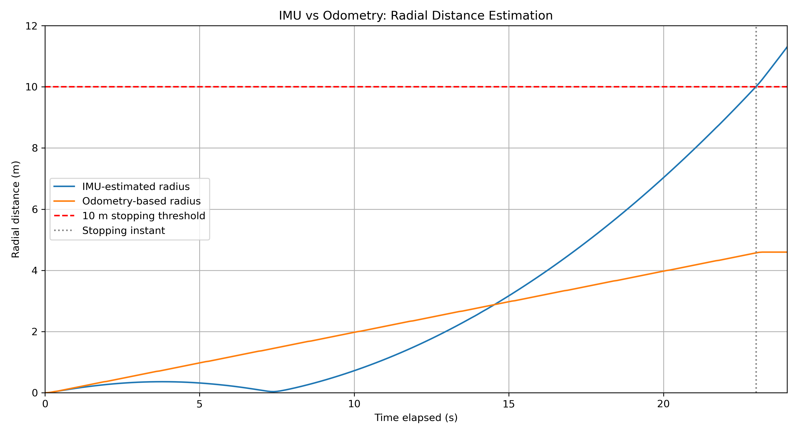

# ROS 2 IMU Autonomy — Radius Stopper

A ROS 2 Humble project that drives a simulated TurtleBot3 Burger forward and commands it to stop when its **IMU-estimated radial displacement** from the starting point reaches 10 m.

The stopping decision uses **IMU data only**. Wheel odometry (`/odom`) is used **only for comparison and evaluation**, never to control stopping.

## Requirements

- Ubuntu 22.04 with ROS 2 Humble
- TurtleBot3 Gazebo simulation and Gazebo Classic (as used in the problem statement)
- Python 3 with ROS 2 packages `rclpy`, `sensor_msgs`, `geometry_msgs`, `nav_msgs`, `std_msgs`
- `colcon` and the ROS 2 launch packages
- Matplotlib (`sudo apt install python3-matplotlib`) for the optional comparison figure

The source package is at `radius_stopper/` inside this repository.

## Build

Clone the repository under your ROS 2 workspace's `src` directory and build the package:

```bash
source /opt/ros/humble/setup.bash
mkdir -p ~/ros2_ws/src
cd ~/ros2_ws/src
git clone https://github.com/Rayhann12345/ros2-imu-autonomy.git
cd ~/ros2_ws
colcon build --packages-select radius_stopper --symlink-install
source install/setup.bash
```

If you already cloned the repository, skip `git clone`. Source `~/ros2_ws/install/setup.bash` in each new terminal that runs this package.

## Run

**Recommended: one-command launch** (starts Gazebo with the TurtleBot3 Burger and runs the stopper node):

```bash
source /opt/ros/humble/setup.bash
source ~/ros2_ws/install/setup.bash
ros2 launch radius_stopper autonomy.launch.py
```

The launch file is at `radius_stopper/launch/autonomy.launch.py` and is installed through `radius_stopper/setup.py`.

**Manual alternative:**

Terminal 1:

```bash
source /opt/ros/humble/setup.bash
export TURTLEBOT3_MODEL=burger
ros2 launch turtlebot3_gazebo empty_world.launch.py
```

Terminal 2:

```bash
source /opt/ros/humble/setup.bash
source ~/ros2_ws/install/setup.bash
ros2 run radius_stopper radius_stopper
```

Stop with `Ctrl+C`. For an explicit manual zero-velocity command if needed:

```bash
ros2 topic pub --once /cmd_vel geometry_msgs/msg/Twist "{linear: {x: 0.0}, angular: {z: 0.0}}"
```

Start with a fresh simulation and stationary robot; do not run another `/cmd_vel` publisher at the same time.

## Method

The node subscribes to IMU readings (`/imu`) and uses the message timestamps to obtain the time step `dt`. For the straight-line, flat-ground case, horizontal accelerations are integrated to estimate velocity and position:

```text
x += vx * dt + 0.5 * ax * dt**2
vx += ax * dt
```

The same updates are applied to `y`/`vy`. The estimated radial displacement is `sqrt(x*x + y*y)`. A 10 Hz control loop commands 0.2 m/s forward motion until this value is at least 10 m; thereafter, it continuously publishes zero velocity. The stop threshold is configurable, for example:

```bash
ros2 run radius_stopper radius_stopper --ros-args -p stop_radius:=10.0
```

No acceleration bias calibration or orientation compensation is applied. The straight-line approximation does **not** cover the optional curved-path challenge.

## Evaluation

Three independent runs were compared against wheel odometry after stopping:

| Trial | IMU estimate at stop (m) | Odometry displacement (m) | Error relative to 10 m (m) |
|:--|--:|--:|--:|
| 1 | 10.072 | 4.617 | -5.383 |
| 2 | 10.065 | 4.658 | -5.342 |
| 3 | 10.082 | 4.638 | -5.362 |
| **Mean** | **10.073** | **4.638** | **-5.362** |

The mean odometry-based stopping displacement was approximately **4.638 m**, or **5.362 m short** of the 10 m target (about **53.62%**). Stationary IMU readings showed an approximate x-axis acceleration offset of -0.06 m/s². This persistent offset is consistent with substantial drift after double integration; noise, tilt-related gravity projection and initial-motion estimation errors may also contribute. Wheel odometry is a comparison estimate, **not exact ground truth**.

See [`results.md`](results.md) for the recorded trial summary and [`short_writeup.md`](short_writeup.md) for the requested two-question discussion.

## Bonus Challenge 1 — IMU vs odometry plot

The node publishes `/imu_radius` and `/odom_radius` as `std_msgs/msg/Float64` for comparison. The Matplotlib plot below was generated from a **separate recorded run**; it is not one of the three summary trials above.



[`plot_results.py`](plot_results.py) reads an existing ROS bag at `~/ros2_ws/recordings/bonus1_trial` and saves `imu_vs_odom.png`. To record a new run, start recording **before** starting the stopper node:

```bash
mkdir -p ~/ros2_ws/recordings
cd ~/ros2_ws/recordings
ros2 bag record -o bonus1_trial /imu_radius /odom_radius
```

Use a fresh recording folder name if `bonus1_trial` already exists. After the robot stops, end recording with `Ctrl+C` and run:

```bash
source /opt/ros/humble/setup.bash
cd ~/ros2_ws/src/ros2-imu-autonomy
python3 plot_results.py
```

## Bonus Challenge 3 — Single-command launch

`radius_stopper/launch/autonomy.launch.py` includes the TurtleBot3 empty-world Gazebo launch and runs the radius-stopper node. It was tested locally to start the simulation and node together.

## Limitations

Uncalibrated acceleration integration accumulates bias and noise over time; the estimated position can continue drifting even after the robot stops. The solution is intended for the minimum **straight-line, flat-ground** scenario. The robot's real stopping accuracy should not be inferred from its 10 m **IMU estimate** alone.